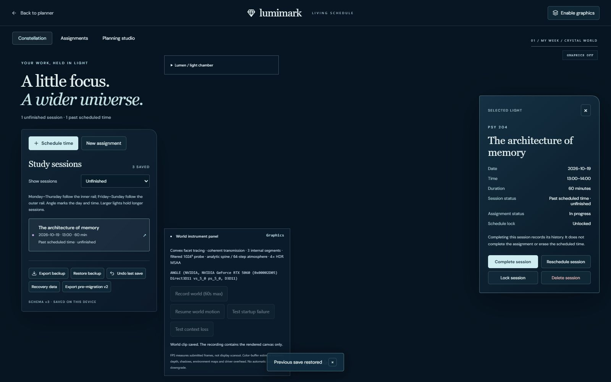
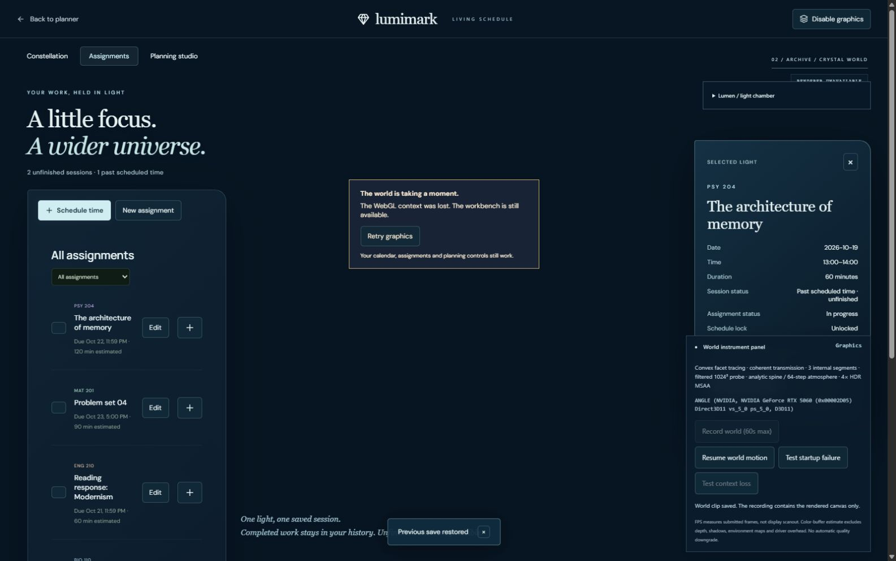

# V2.2 — Living Schedule Constellation

Base: verified `main` / `bf1c41f`. Feature branch: `codex/living-schedule-constellation`. Open `/#crystal` for real saved study sessions, or `/#demo` for the preserved disposable visual workspace. This feature is for acceptance on its PR, not automatic merge or deployment.

## Behavior and boundary

`constellation/adapter.ts` reads the existing workspace and produces immutable presentation records keyed by session ID. Assignment-linked calendar blocks become orbs; personal commitments remain in the calendar. Weekday/time determine angle, duration determines aura size, and course supplies color. Small bounded stacks separate matching times across weeks. The full semantic session list is paginated at 20; at most 64 non-overlapping on-screen hit targets supplement it. No academic record is culled by that limit. Very dense coincident lights can still overlap visually; the complete HTML list is authoritative for selection.

The existing HTML academic dialog, assignment controls, planning/approval panel, backup and storage operations are reused. Domain writes finish before the GPU observes the resulting snapshot. The renderer owns only IDs, visual values and transient bounded effects. `world/orbLifecycle.ts` keeps at most 48 recent transitions, replacing interrupted transitions for the same ID. The current constellation is always reconstructed from the entire snapshot, independent of the effect budget.

Instanced optical coronas, faceted luminous kernels and restrained arc segments share the existing HDR scene, six-face refraction probe and planar receiver. Creation gathers at Lumen and travels to a rail; rescheduling sweeps along the rail; completion returns energy to Lumen; deletion has a quieter fade and reduced environmental pulse. Existing light circuits drive coordinated crystal, rail, haze, particles and pedestal wave responses. Selection reframes outside the crystal, slows rail motion, and provides an optical focus marker even when the light is occluded. The approved Lumen cut, coherent transmission, beacon and restrained bloom remain unchanged.

## Data and rollback

Schema v3 adds optional `sessionCompleted` on linked blocks and `locked` on blocks. Absence means unfinished/unlocked. V2 import/read migration changes only the schema marker and preserves IDs, dates, metadata and assignment completion. It never guesses that an assignment-completed session was completed. Ambiguous new status fields in a v2 file are rejected.

Session completion preserves its historical scheduled interval, conflict occupation and estimated-work accounting. It does not complete its assignment. Locks prevent rescheduling/relinking/deletion; completion remains separate. Existing deadline/conflict/estimate validators and stale-revision approval remain mandatory. Model extras cannot set completion or lock flags: proposal application explicitly whitelists the accepted time fields.

Read-time migration does not write storage. On the first explicit save over a v2 primary, its exact bytes are retained at `homebase.v2.schema-v2` before any primary write. Failure aborts the save. Export that pre-migration snapshot and the current v3 backup before a code rollback. V2 code cannot read v3 completion/lock semantics; its recovery UI can restore the v2 snapshot while preserving the rejected v3 raw data. The snapshot is historical and does not contain later edits. Existing rollback/recovery keys, canonical UTF-8 byte limits and Web Locks safety remain in place. Extra snapshot storage can make quota exhaustion occur earlier; saves report failure and preserve primary data.

## Verification

- 90 automated tests including valid 300-session multi-week projection, exact ID reconstruction, approval/application metadata, v2 migration, original-byte preservation and quota failure, completion/locks, actual edit submission after reopening/unlinking, Blob/file export/import, undo and stale-tab guards, bounded/interruptible effects, static camera projection and recording lifecycle.
- TypeScript, production build, dependency consistency and npm audit. No inference or model download needed.
- Actual Chromium / RTX 5060 desktop browser at 1600×1000: create assignment and linked sessions; exactly one additional orb per saved session; direct orb and keyboard list selection; same-ID rescheduling; separate completion and deletion effects; completed history with assignment still in progress; lock blocks both move/delete; reopen/unlink regression; undo; actual JSON export/file-picker restore; reload reconstruction.
- Graphics disabled: semantic session inspection/completion/undo remain usable. Injected startup failure and actual WebGL context loss recover through Retry with correct active/total counts and **zero replayed arrival effects**. Browser testing corrected inherited failure-overlay positioning and separated diagnostics from action controls.
- Freeze/static mode: world time stops, navigation and hit targets update immediately, and no transient waves resume later. OS reduced-motion preference wiring is preserved; the actual OS preference toggle was not changed in this run.
- Independent Codex review found five defects (reopened-session conversion metadata, proposal extras, stale static camera matrices, focus restoration, and diagnostics/detail overlap at narrow desktop widths); all were corrected, regression-tested and independently rechecked. No remaining confirmed blockers. Follow-up review requested on the PR.
- An attempted generated 33-session browser import was rejected by automatic approval review because it would overwrite planner state. It was not executed or bypassed. Crowding is covered by valid 300-session regression tests; browser visual checks use the sessions created through normal controls.

## Motion and visual evidence

[Recorded real session lifecycle, ~51 seconds, 1600×1000 WebM](session-lifecycle.webm). This is the actual rendered canvas, with no mock scheduling events. Sequence: creation → selection/reframe → rescheduling → completion/energy return → separate quiet deletion. The semantic forms are outside the canvas; screenshots below show their record details. Recording adds encoding overhead, and is explicitly user-started, capped at 60 seconds, with stream/timer cleanup on cancellation/error.

## Measured costs and limitations

Development samples: about 307–333 ms to the first rendered frame, ~128–142 submitted FPS when settled, ~110–120 FPS during recording/interaction. Sampled GPU ~1.2–1.7 ms, CPU submission ~2.0–2.7 ms. First-frame/reinitialization stalls reached ~170–220 ms. These are renderer telemetry, not end-to-end navigation timing or scanout. [Live](performance-live.txt) and [static](performance-static.txt) telemetry retain raw observations.

The final production bundle (`index-Dwg0-oLb.js`) was checked separately on the existing preview origin without changing its academic data. Its existing v2 session reconstructed in memory as v3, with zero arrival effects. At the browser's default 970×545 CSS viewport / 1264×719 render buffer, startup was 356 ms, settled submission rate ~142 FPS, CPU ~1.8–1.9 ms, sampled GPU 1.5 ms, p95 interval 9.3 ms and worst interval 145.4 ms. It used 557 draw calls / ~372,000 triangles including passes, 39 geometries / 18 textures / 39 programs, and ~229.7 MB of estimated HDR color buffers. This smaller viewport is not a direct performance comparison with the 1600×1000 development recordings. [Production telemetry](performance-production.txt), [production view](production.jpg).

New resources: four small geometries, six additional compiled shader variants observed, instanced buffers about 0.83 MB by arithmetic (not total GPU memory). Texture count remains 18; no additional full-screen/cube render targets. Existing HDR color buffers remain ~286–287 MB at this viewport, excluding depth/maps/shadows/driver overhead. Reflection and cube passes also render the orbs, so their draw/triangle costs multiply across passes. High-volume effect bursts retain all schedule records but animate only the latest 48 effects. Maximum-size 5,000-block schedules, physical mobile devices and new model performance are not benchmarked.

Remaining visual compromises: nominal wall-clock timing (no timezone/reminder system); crowded coincident lights use bounded stacks and semantic-list selection; a selected light has an intentional through-occlusion focus aura. Recording captures only the GPU canvas. Schema-v3 backups require this version; retain the v2 snapshot for older-code rollback. No deployment or merge performed.
