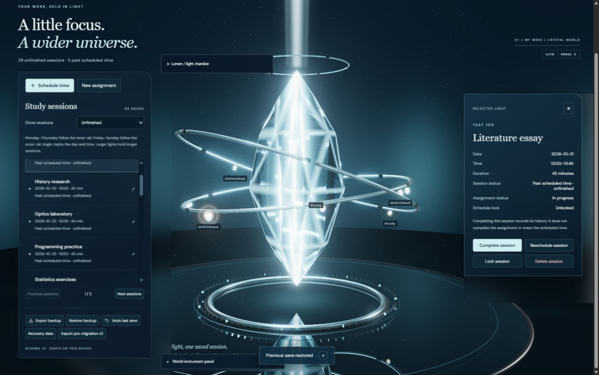

# V2.2 final acceptance

Implementation reviewed: PR #9, `03271694db8f857eec04d11ab21dfd5f2208f4f9`. This follow-up records verification and deferred work; it changes no application behavior.

## Functional results

| Scenario | Result | Evidence |
| --- | --- | --- |
| Rescheduling | PASS | In the browser, `accept-s01` moved from Oct 20 13:00–13:45 to Oct 22 15:00–15:45. The selected detail, projected orb label/position and actual downloaded backup agreed. Exactly 33 distinct session IDs remained. Undo restored the original time on the same selected ID. Existing regression tests also verify the changed orbital angle and same-ID lifecycle transition. |
| Persistence and recovery | PASS | Reload reconstructed 29 active lights from 33 persisted sessions, with zero arrival effects. The actual downloaded backup was restored through the file picker and reloaded. All four completion flags and five locks survived. A four-session schema-v2 backup imported successfully as v3; undo returned all 33 IDs and their flags. A complete, locked session still showed its original interval, independent assignment status and disabled reschedule/delete controls. |
| Crowded constellation | PASS | Six courses and 33 sessions over five weeks, including repeated weekday/time positions, past unfinished work, four completed sessions and five locks. Both semantic pages contained 33 distinct IDs. All 33 selections matched their assignment, date, time and lock state. An unobstructed direct orb selection opened the matching Literature essay record and selected target. Dense clusters remain accessible through the full list even when projected hit targets are culled. Existing valid 300-session projection tests cover bounded stacks, deterministic order and identity reconstruction. |

The browser workspace used a newly started disposable origin, `http://127.0.0.1:43129`, separate from the user's existing planner origins. All fixture imports and scheduling changes were confined to that origin. No existing user planner data was overwritten, exported or restored. This explicit isolated-fixture authorization enabled the crowded browser check that was previously blocked; no safeguard was bypassed.

During injected renderer initialization failure, rescheduling to 16:00–16:45 and undo both succeeded through the semantic controls. Retry reconstructed 29 active / 33 total sessions with zero replayed arrivals. Previous context-loss and static-motion evidence remains applicable because application code is unchanged.

## Review and regression gate

- GitHub's PR discussion and review submissions were checked: the `@codex review` request has no response and there are no submitted GitHub reviews or actionable new findings. This is not a claim of GitHub approval.
- The completed independent local Codex review previously found five issues: conversion metadata after reopening, model-injected status fields, static projection matrices, focus restoration and diagnostics/detail overlap. Their fixes and regression tests are present at the reviewed implementation commit; no application changes were needed during final acceptance.
- Focused domain/storage/constellation/editor regression checks: **55 passed**. Full suite: **90 passed in 13 files**. TypeScript and production build passed. Existing large lazy renderer/WebLLM chunk warnings remain.
- Dependency consistency passed and npm audit reported **0 vulnerabilities**. Merge remains conditional on the final PR checks and GitHub's merge gate; no branch protection may be bypassed.
- Migration preserves legacy IDs, floating dates and metadata. Snapshot quota failure preserves the primary bytes. Session completion remains separate from assignment completion; completed intervals still occupy the calendar. Locks block editing and deletion until explicit unlock. AI proposals cannot inject status flags and still require validated approval.

## Deferred V2.3A visual issues

1. **Materialization reads as appearing on a rail.** Create an assignment-linked session while viewing `/#crystal` with motion enabled. The current gather/travel transition is present but does not communicate a convincing continuous journey from Lumen. Refine the visual path and energy continuity; do not change the committed-session creation boundary.
2. **Selection indicator trails moving geometry.** Select a light with live orbital/camera motion, especially during a camera reframe. Projected HTML targets update at roughly 10 Hz while geometry updates each frame, so the focus/label may visibly lag. Rechecked selection after the camera settled opens the correct record; the complete keyboard-accessible list remains available. Improve visual tracking in V2.3A without coupling presentation to scheduling. Rapid automated reads during a transition are not used as proof that selection has settled.
3. **Smaller-window composition glitches.** Narrow a desktop window around the 1120 px stacked-layout breakpoint, with session details or diagnostics open, and scroll the page. The existing fixed world/diagnostics and stacked content can produce awkward composition. The earlier 1024 px diagnostics/action overlap correction remains; semantic controls and focus scrolling are functional. Revisit layout consistency in V2.3A, separately from this merge.

No new rendering benchmark, physical-mobile claim, live AI inference, model download or deployment forms part of this acceptance check. Maximum-size 5,000-block visual performance remains unverified.
