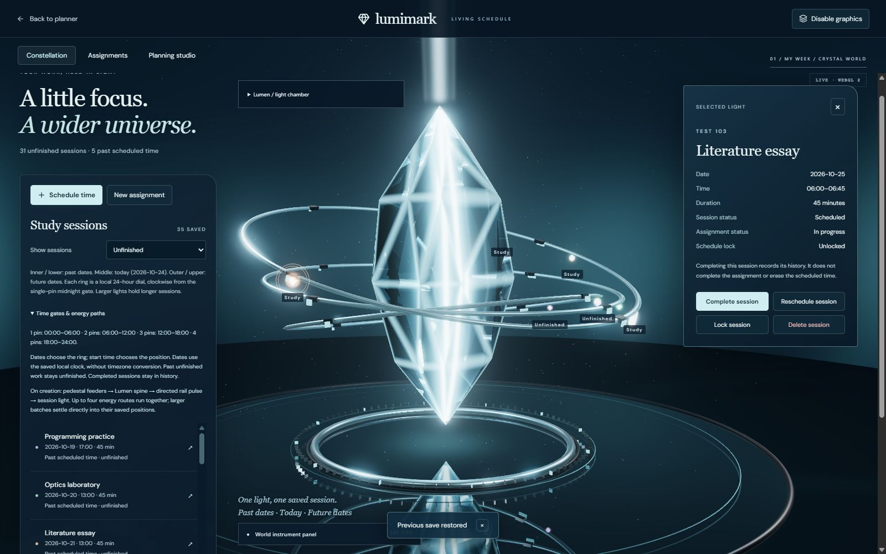
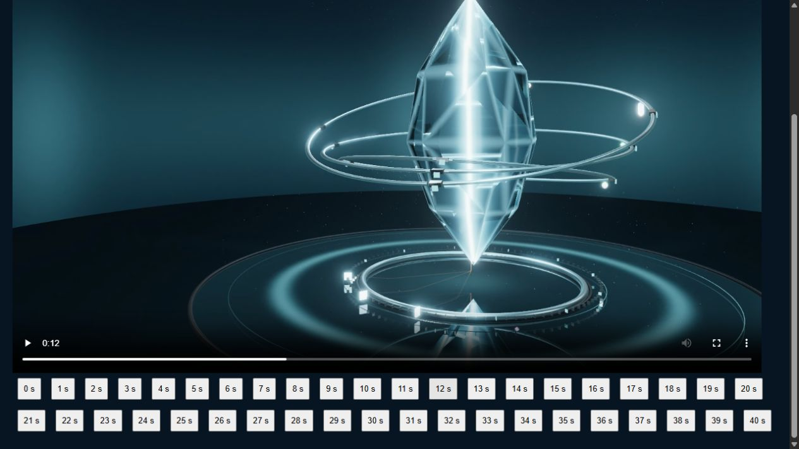
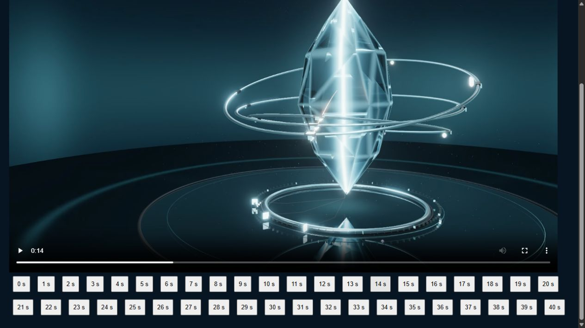
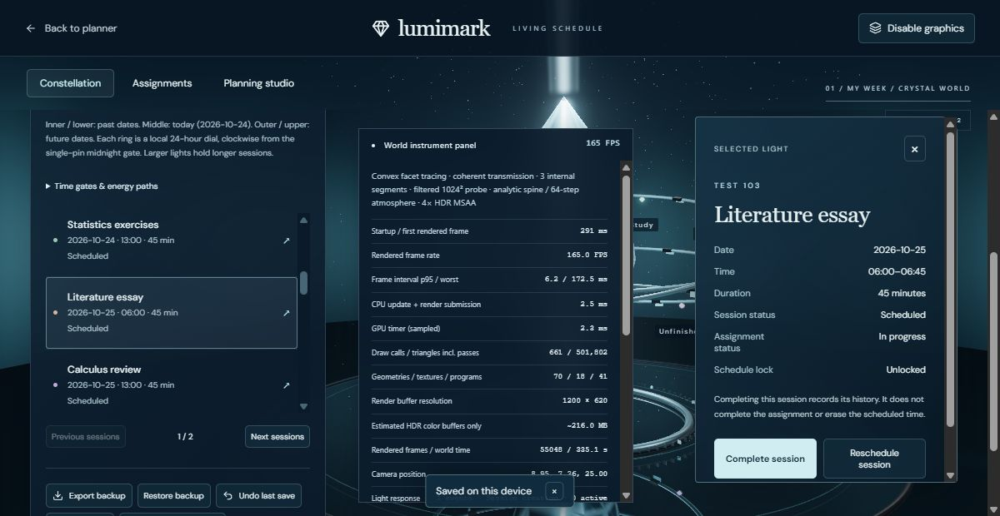
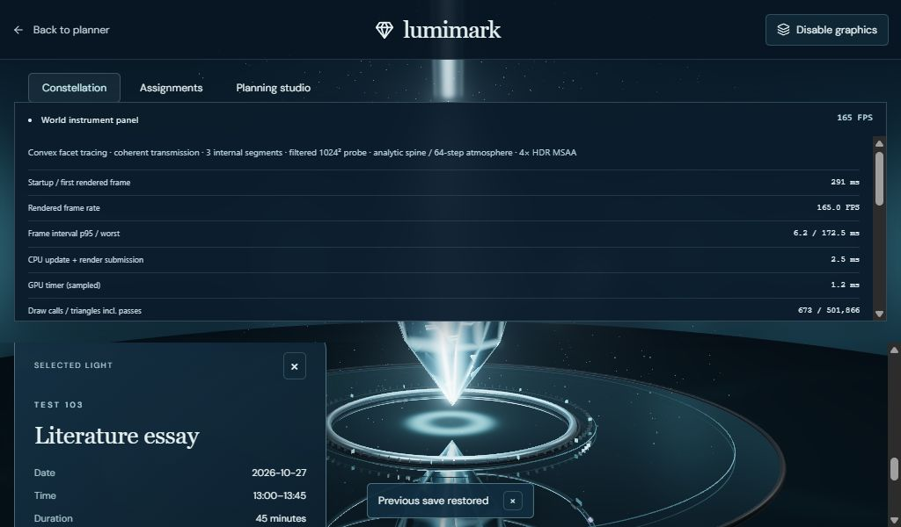

# V2.3A — Energy and temporal constellation

Base: verified `main` / `e443e42`. Branch: `codex/energy-temporal-constellation`. Run `npm run dev`, then open `/#crystal`. The disposable browser demonstration used `http://127.0.0.1:43130/#crystal`; existing planner origins were not overwritten. No merge or deployment is part of this milestone.

## Observable changes

- A committed creation activates three existing pedestal instruments. Organized curved feeders converge at the base, rise through Lumen's spine, and exit along a directed path to the exact destination transform. The orb materializes after the energy reaches its ring. The 4.6-second sequence shares its route math with the moving energy heads; it does not substitute a CSS transition for the renderer.
- At most four creations route simultaneously. Large imports retain every saved session while the remaining lights settle directly. Rapid light events coalesce into a maximum of four wavefronts. Gaussian edges, temporal dissolution and radial falloff bring pulses smoothly to zero. Actual routed energy modulates pedestal/core lighting and the shared rail/particle/reflector response; idle atmosphere does not generate creation pulses.
- Inner/lower ring: **past local dates**. Middle ring: **today**, explicitly dated in the legend. Outer/upper ring: **future local dates**. Each ring shares a clockwise 24-hour dial. One, two, three and four gate pins mark 00:00, 06:00, 12:00 and 18:00. Gate-relative position comes from the saved local start time, with bounded depth/radius stacks for coincident clock positions. No jitter crosses gate boundaries. Past unfinished sessions remain unfinished; completion stays explicit and separate from assignment completion. This adds no daily-plan grouping or data model.
- The GPU focus uses the same position as the orb. Projected HTML hit targets update imperatively from that rendered frame's transforms, without a per-frame React state update for coordinates. Membership changes still use React. Interrupted effects retain the displayed position and opacity rather than jumping to their destination.
- Short desktop layouts scroll their semantic content; selected details have a bounded scroll area. Narrow layouts put environment/diagnostic controls into normal flow, keeping them separate from session actions. Only one expanded environment instrument is shown at a time. The normal calendar UI and academic operations are unchanged.

## Actual browser evidence

[18.069-second, 1600×1000 canvas recording](energy-lifecycle.webm): the real creation of Literature essay on 2026-10-25 at 06:00, using the normal form and validated save. Around 12 seconds, pedestal feeders and the base wave are visible; around 14 seconds, the directed exit is visible; by 16 seconds, the light is on the ring and the wave has dissipated. The clip contains the canvas, not the HTML forms. Playback was inspected in the browser. A retained download link now lets users retrieve the latest clip after automatic stop; its URL is revoked on replacement or unmount.

The isolated workspace imported 33 valid sessions across six courses and five weeks (four completed, five locked), then created two additional sessions through normal controls. The browser verified a 06:00 future-ring session, direct orb selection and correct details, movement into today's ring at 07:00, undo back to the future date, and selection of a locked record. Live desktop resizing used 1200×620, 1024×600 and 1440×500 viewports; no horizontal overflow was measured. The 1440×500 detail panel stayed within the viewport and its reschedule dialog remained usable. At 1024×600, keyboard focus scrolled the selected heading into view and locked rescheduling stayed disabled. Long lists/details intentionally require scrolling.

Injected initialization failure preserved completion and undo operations. Retry and actual context-loss recovery rebuilt **31 active / 35 total** sessions with **zero replayed arrivals**. Freeze/static navigation kept the clock stopped and updated projections immediately. Assignment and planning views remained navigable with the model unloaded. Import/reload/undo used the existing schema-v3 storage path; no scheduling, persistence, backup schema, lock or inference implementation changed.

## Tests, review and costs

**97 tests pass in 14 files**, plus typecheck, production build, dependency consistency and npm audit (**0 vulnerabilities**). Focused tests exercise midnight/year boundaries, all six-hour gates, deterministic crowded stacks, continuous route endpoints, bounded bursts, quiet cancellation, per-frame camera/orbit/reschedule/rapid-selection tracking, interrupted unmaterialized births and recovery baselines. Existing migration, approval, storage, lock and backup tests remain intact.

Independent read-only Codex review found two defects: interrupted births could jump to the rail, and newline-delimited imported IDs could collide in the projection membership key. Both were fixed and independently rechecked. No remaining confirmed blockers were reported. A GitHub follow-up review is requested on the PR; this is distinct from a submitted GitHub approval.

RTX 5060 / Chromium, 1600×1000, 35 sessions: settled samples around **159–165 submitted FPS**, CPU submission about **2.3–2.8 ms**, sampled GPU about **1.6–3.0 ms**. Observed initialization was **258–291 ms** on later runs (one first development initialization reached **1022 ms**); recovery was **153–173 ms**. Sampled worst intervals reached **106–172 ms**, including initialization/resizing. These are renderer submission metrics, not scanout or end-to-end navigation times. [Live telemetry](performance-live.txt), [static telemetry](performance-static.txt).

The scene reports **70–71 geometries, 18 textures and 41 programs**, roughly **636–673 draw calls / 463k–502k triangles including reflection/probe passes**, and about **287.3 MB of HDR color buffers**, excluding depth, environment maps and driver overhead. Additional costs include gate geometry, bounded dynamic line/head buffers and per-frame HTML projections. No additional full-screen or cube render target was introduced. Renderer code remains lazy-loaded; its final bundle is about 606 kB (157 kB gzip), with the existing large WebLLM chunk warning unchanged.

Limitations: the date anchor refreshes at minute granularity; nominal wall-clock dates do not imply timezone conversion/reminders. Four routed effects are a deliberate presentation budget, not a session-data limit. Dense coincident lights still depend on the full semantic list for reliable individual selection. The recording is canvas-only. The actual OS reduced-motion toggle, physical mobile devices and maximum-size 5,000-block GPU performance were not retested; the shared static/reduced-motion path was exercised. V2.3B's workspace redesign remains deferred.
