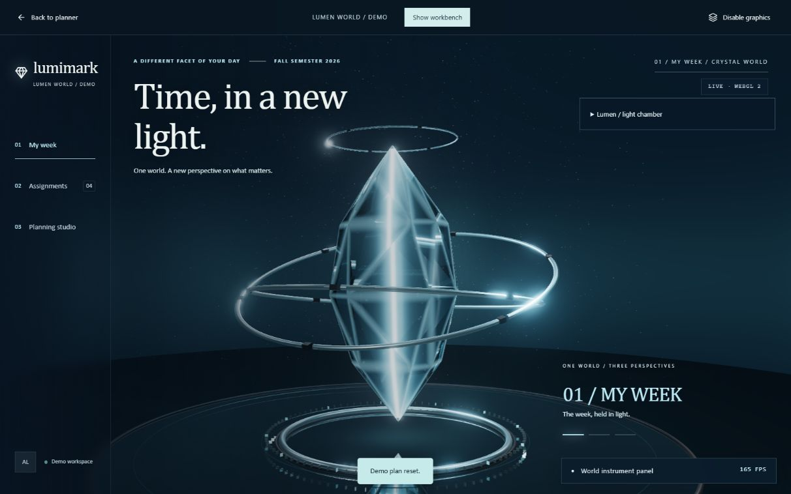
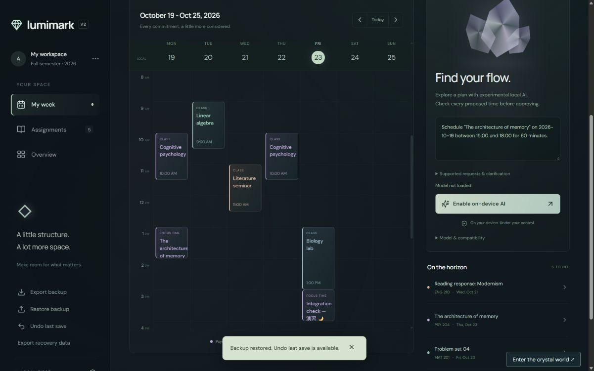
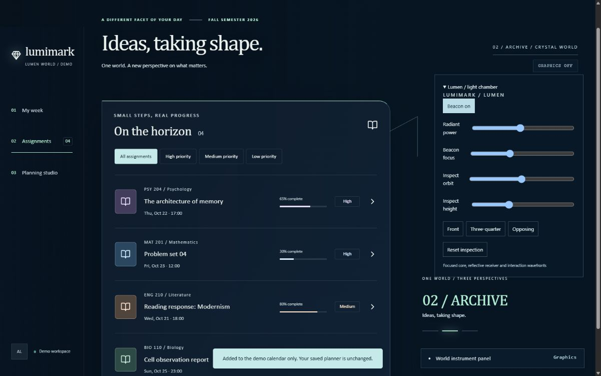
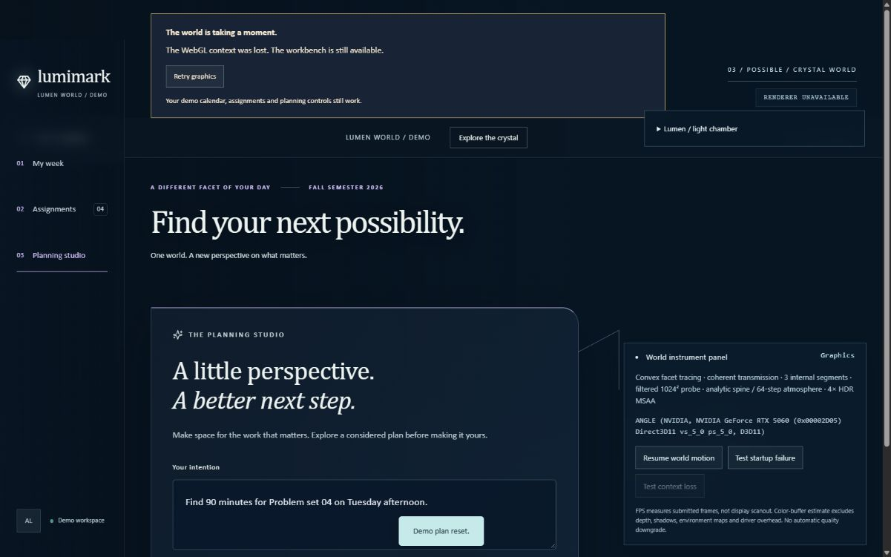

# Lumimark V2 integration verification

Foundation: PR #1 at `158294a`, merged as `acff845`. Selected visual baseline: PR #7 at `e942c11`, containing the shared development from #2–#7. The integration starts from foundation main and imports one selected visual snapshot rather than merging every experiment.

## Retained / removed

Retained: exact Lumen cut and plane tracing, coherent transmission and internal spine, 64-step beacon, filtered environment probe, HDR MSAA, reflective receiver, metallic orbital rails, particles, bounded causal light/wave events, three spatial viewpoints, inspection controls, semantic fixture workflows, Lumimark branding, graphics opt-out, reduced motion, failure/retry and context-loss recovery.

Removed: Aether/Meridian/Prism chooser and alternate compositions, original/Vesper gemstone geometries, gallery and optical reference branches, legacy dispersion/refraction toggles, recording UI/module, duplicate comparison tests, and the branch-specific staging deployment workflow. Historical evidence and Git branches remain preserved. Legacy audition/world URLs resolve to Lumen.

Academic domain, persistence, backup serialization, intent validation and inference implementation are unchanged from PR #1. Independent integration review identified one lifecycle defect: leaving the planner during inference abandoned its running worker. `usePlanning` now cancels active generation on unmount, invalidates late proposals, and ignores obsolete initialization callbacks. Three deterministic lifecycle regressions cover unmount, late loading and explicit-cancel settlement. No live inference/download was needed.

## Verification

- Complete suite: 71 tests; TypeScript project check and production build; dependency resolution and npm security audit (zero vulnerabilities).
- Actual Chromium desktop production preview, 1600×1000 viewport, NVIDIA RTX 5060 / ANGLE D3D11.
- Create Unicode assignment (`演習 🌙`), manually schedule adjacent to a class, reload persistence, actual JSON export, undo, actual file-picker restore, edit estimated duration and undo. Final exported assignment/block data exactly match the initial backup; revision increases as expected. Storage keys and schema v2 are unchanged.
- Calendar, assignment and planning viewpoints; scripted preview requires approval and explicitly changes only fixture data. Return to saved planner preserves academic data.
- Disable graphics and navigate; injected startup error retains usable form controls; retry constructs a working renderer. Actual WebGL context loss shows fallback and retry restores rendering.
- Freeze exercises the shared reduced-motion path: static world time, immediate navigation, no interaction waves. Automated tests verify latest reduced-motion input during delayed startup and event retirement on preference changes. OS preference was not toggled during this check.
- Live idle frames and world time advance; navigation and beacon changes produce distinct counted responses. No console errors observed in the walkthrough.
- Independent review: one actionable lifecycle finding fixed and verified; no remaining production findings. Formal GitHub approval remains governed by repository merge requirements.

## Measured costs / limits

Representative warm renderer startup 179–194 ms; settled 165 submitted FPS; p95 interval about 6.2 ms. RTX 5060 sampled GPU time 1.7–3.5 ms; CPU submission about 1.8 ms. A reinitialization sample included an approximately 80 ms first-frame stall. These are renderer telemetry, not end-to-end page load or display scanout. See [live telemetry](performance-live.txt) and [static telemetry](performance-static.txt).

About 286–287 MB estimated HDR color buffers alone at this viewport, excluding depth, probes, shadows and driver overhead; 36 geometries / 18 textures / 33 programs. Desktop visual fidelity remains expensive. WebGL2 HDR capability is required for graphics; semantic workflows and the academic planner remain available without it. Mobile/physical iPhone compatibility and new live-model performance were not re-evaluated. The large lazy renderer and WebLLM/Wasm bundle warnings remain expected. No deployment was performed.

## Evidence

